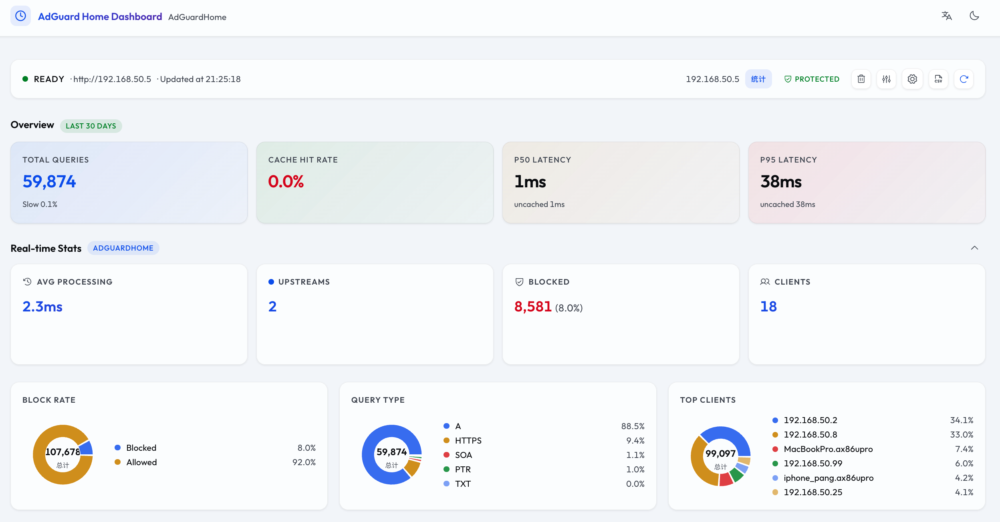
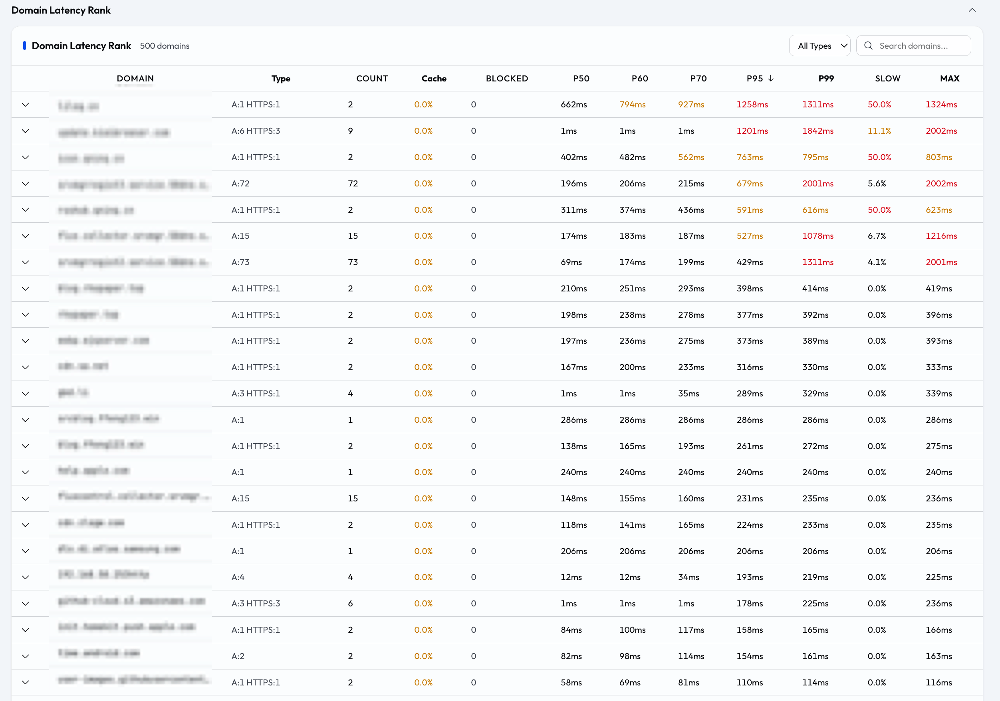
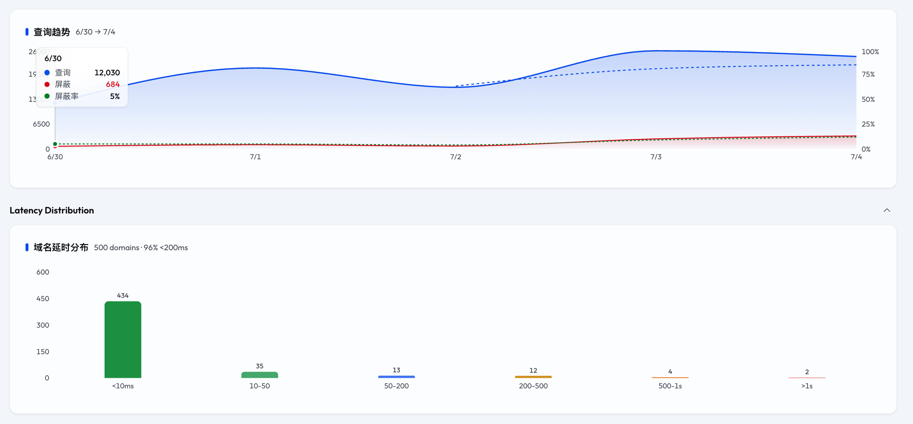
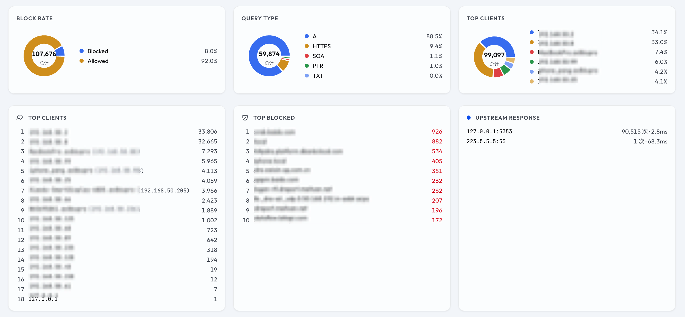

# AdGuard Home Boost

<a href="README.zh.md"><svg width="16" height="16" viewBox="0 0 24 24" fill="none" stroke="currentColor" stroke-width="2" stroke-linecap="round" stroke-linejoin="round" style="vertical-align: -3px; margin-right: 2px;"><circle cx="12" cy="12" r="10"/><line x1="2" y1="12" x2="22" y2="12"/><path d="M12 2a15.3 15.3 0 0 1 4 10 15.3 15.3 0 0 1-4 10 15.3 15.3 0 0 1-4-10 15.3 15.3 0 0 1 4-10z"/></svg> 中文版</a> · [English](README.md)

**The better dashboard for your AdGuard Home** — Analyze DNS latency, monitor traffic in real time, and manage your DNS settings — all in one place.

[](https://github.com/xiebaiyuan/adguard-home-boost/releases)   [](https://hub.docker.com/repository/docker/xiebaiyuan/adguard-home-boost)  

---

## 📸 Screenshots

  
  
  


---

## 🚀 Quick Start

```bash
git clone https://github.com/xiebaiyuan/adguard-home-boost.git
cd adguard-home-boost
npm install
npm run dev
# Backend → http://localhost:3080
# Frontend → http://localhost:5173
```

Open `http://localhost:5173` in your browser. Click the ⚙️ icon, enter your AdGuard Home address, username, and password, then hit Refresh. That's it.

**Prefer Docker?**

```bash
docker run -d --name adguard-home-boost \
  -p 3080:3080 \
  -e ADGH_URL=http://192.168.1.100 \
  -e ADGH_USER=your_username \
  -e ADGH_PASSWD=your_password \
  -e ADGH_SKIP_VERIFY=true \
  -e ADGH_AUTH_USER=admin \
  -e ADGH_AUTH_PASSWD=change-me-to-a-long-random-string \
  xiebaiyuan/adguard-home-boost:latest
```

`ADGH_AUTH_USER` / `ADGH_AUTH_PASSWD` are this panel's own HTTP Basic credentials.
Every route asks for them, including `/api/health` and the static files. Leave them
out and the container stops right away: the image sets `HOST=0.0.0.0`, and without
credentials the app accepts a loopback bind address only.

---

## ⚠️ Upgrading from an earlier release (breaking change)

Every route now requires HTTP Basic credentials. If neither `ADGH_AUTH_USER` nor
`ADGH_AUTH_PASSWD` is set, the server refuses to bind a non-loopback address and
exits with a non-zero status. The Docker image ships `HOST=0.0.0.0`, so an existing
container will not start until you do one of the two things below.

**Option A — set credentials, keep LAN access.** `docker-compose.yml` reads these
values from a `.env` file next to it:

```bash
cd /path/to/adguard-home-boost
cat >> .env <<'EOF'
ADGH_AUTH_USER=admin
ADGH_AUTH_PASSWD=change-me-to-a-long-random-string
EOF
docker compose pull && docker compose up -d
```

Open the dashboard and the browser asks for that username and password.

**Option B — no credentials, loopback only.**

```bash
cd /path/to/adguard-home-boost
echo 'HOST=127.0.0.1' >> .env
docker compose pull && docker compose up -d
```

The app then listens on the container's own loopback only. With the port mapping in
`docker-compose.yml` that also means `http://<host>:49241` stops answering. For
Docker access from the host alone, either keep Option A or publish the port on the
host loopback by changing the mapping to `127.0.0.1:49241:3080`.

---

## ✨ Features

### 📊 DNS Latency Analysis
Ever wondered which domains are slow to resolve? This panel breaks it down per domain — P50, P95, P99, max, average, and more.

- **Per-domain stats** — P20 / P50 / P60 / P70 / P95 / P99 / Max / Avg / Min, sortable and filterable
- **Cache-aware** — Cached vs uncached stats separated, showing real upstream performance vs user experience
- **Slow query grading** — >500ms highlighted as slow, >1s as severe, with per-domain rates
- **Latency histogram** — Color-coded bar chart (green → yellow → red) showing P95 distribution at a glance
- **Trend chart** — Dual Y-axes (query volume + block rate) with 3-day moving average

### 🎛️ DNS Management
Control your AdGuard Home directly from the dashboard. No need to open a separate admin page.

- **Protection toggle** — Pause or resume DNS blocking instantly (optimistic UI, no waiting)
- **Safe Browsing & Parental Control** — Flip the switches
- **DNS rewrites** — Add, edit, or remove custom rewrite rules
- **Filter subscriptions** — Add, enable, disable, or remove filter lists
- **Custom rules** — Edit your own filtering rules
- **Maintenance** — Reset stats, clear query logs, flush DNS cache

### 📈 Real-Time Statistics
AdGuard Home's built-in stats, rendered beautifully.

- **Block ratio donut** — Shows total queries vs. blocked, with percentages
- **Query type breakdown** — A, AAAA, PTR, HTTPS, and more
- **Top clients** — Which devices (IP + name) are making the most queries
- **Top blocked domains** — The most frequently blocked domains
- **Upstream response times** — Each upstream's latency and query count
- **Trend chart** — Daily query and block volume over time

### 🔍 Dive Into Any Domain
Click any domain row to expand a detailed view:

- **Who's querying it** — See the client IPs and device names
- **Block rules** — If it's being blocked, see which rule is responsible
- **Upstream breakdown** — Which DNS servers handled the queries and how fast
- **Resolved addresses** — IP addresses returned, with TTL ranges
- **Recent queries** — Last 20 log entries for this domain (exportable as CSV)

### 🌐 Internationalization
- **Chinese & English** — Auto-detects your browser language, toggle anytime in the header
- **Dark mode** — Follows your system preference, switch manually too

### 🏎️ Nice Touches
- **Multi-profile** — Save multiple AdGuard Home connections and switch between them
- **Time range** — Analyze the last 24 hours, 7 days, or 30 days
- **CSV export** — Download summary stats or raw query logs
- **Smooth loading** — Shimmer placeholders while data loads, content fades in when ready
- **No layout shifts** — Cards reserve their space even before data arrives
- **Lazy-loaded charts** — Recharts loads only when the stats panel is expanded
- **Cache reuse** — Refreshing within 5 minutes avoids re-fetching AdGuard Home logs (keeps low-power devices cool)

---

## 🏗️ How It Works

```
┌─────────────┐     ┌─────────────┐     ┌──────────────────┐
│  Browser SPA  │────▶│ Fastify API  │────▶│ AdGuardHome API  │
│ (Vite+React) │◀────│ + Analysis   │◀────│ /control/querylog│
└─────────────┘     └─────────────┘     └──────────────────┘
                         │ Cached
                    ┌────▼────────┐
                    │  5-min TTL   │
                    └─────────────┘
```

**Frontend:** Vite + React + Tailwind v4 + Recharts + Phosphor Icons  
**Backend:** Fastify + TypeScript, 8 API endpoints, in-memory cache with 5-minute TTL

---

## ⚙️ Environment Variables

| Variable | Description | Default |
|----------|-------------|---------|
| `ADGH_URL` | Your AdGuard Home address | — |
| `ADGH_USER` | Admin username | — |
| `ADGH_PASSWD` | Admin password | — |
| `ADGH_SKIP_VERIFY` | Skip SSL certificate verification | `false` |
| `PORT` | Server port | `3080` |
| `HOST` | Listen address. Without credentials only a loopback address (`127.0.0.1` / `localhost` / `::1`) is accepted; a non-loopback value makes the process exit at startup. The Docker image sets `0.0.0.0` | `0.0.0.0` |
| `ADGH_AUTH_USER` | HTTP Basic username for this panel. Auth is on when this and `ADGH_AUTH_PASSWD` are both non-empty | — |
| `ADGH_AUTH_PASSWD` | HTTP Basic password for this panel | — |

---

## 💖 Credits

All data comes from [AdGuard Home](https://github.com/AdguardTeam/AdGuardHome) — an excellent open-source network-wide ad and tracker blocker.

## 🌐 Friends

[Linux.Do](https://linux.do/) — A vibrant open-source community with a strong technical atmosphere. Everyone is welcome!

---

## 📄 License

MIT © xiebaiyuan
