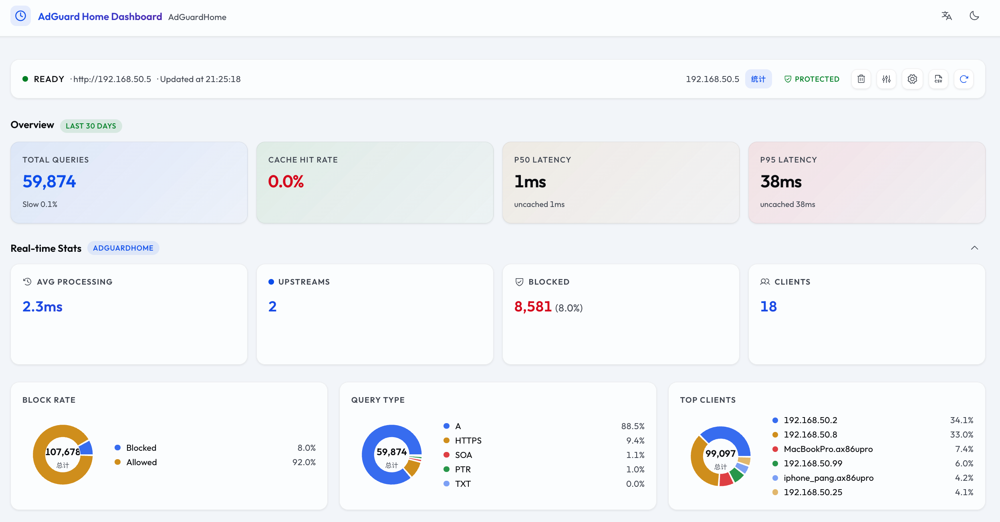
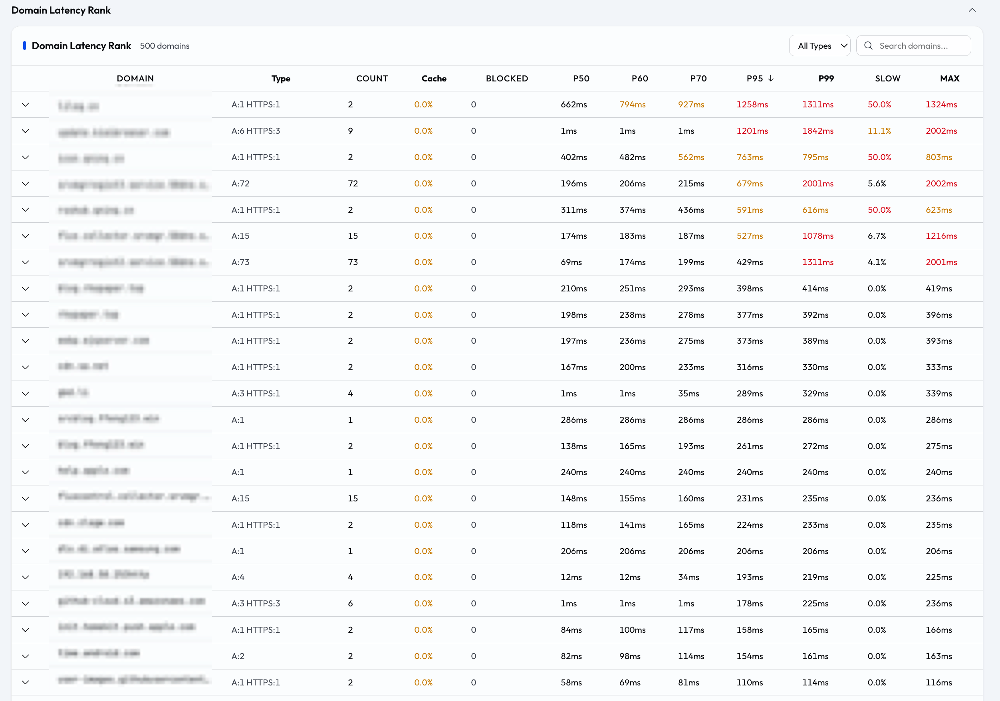
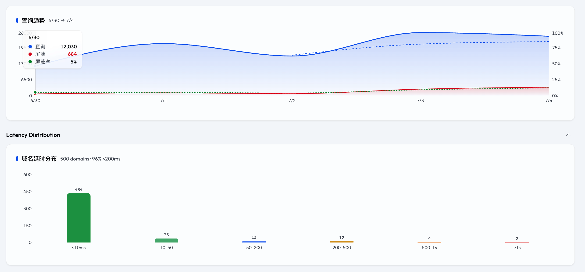
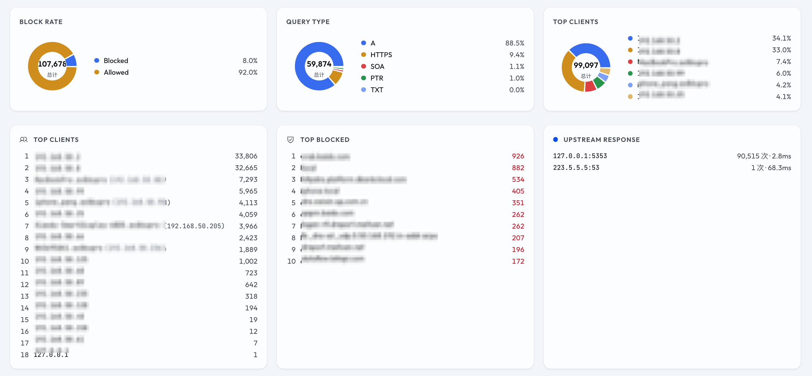

# AdGuard Home Boost

<a href="README.md"><svg width="16" height="16" viewBox="0 0 24 24" fill="none" stroke="currentColor" stroke-width="2" stroke-linecap="round" stroke-linejoin="round" style="vertical-align: -3px; margin-right: 2px;"><circle cx="12" cy="12" r="10"/><line x1="2" y1="12" x2="22" y2="12"/><path d="M12 2a15.3 15.3 0 0 1 4 10 15.3 15.3 0 0 1-4 10 15.3 15.3 0 0 1-4-10 15.3 15.3 0 0 1 4-10z"/></svg> English</a> · [中文](README.zh.md)

**AdGuard Home 增强型管理面板** — 分析 DNS 延时、实时监控流量、管理 DNS 设置，一个页面全搞定。

[](https://github.com/xiebaiyuan/adguard-home-boost/releases)   [](https://hub.docker.com/repository/docker/xiebaiyuan/adguard-home-boost)  

## 📸 截图

  
  
  


---

## 🚀 快速开始

`package.json` 的 `engines` 要求 `^20.19.0 || >=22.12.0`；Docker 镜像和 CI 都跑 Node 22。

```bash
git clone https://github.com/xiebaiyuan/adguard-home-boost.git
cd adguard-home-boost
npm install
npm run dev
# 后端 → http://localhost:3080
# 前端 → http://localhost:5173
```

打开 `http://localhost:5173`，点击 ⚙️ 图标填入 AdGuard Home 地址、用户名、密码，点击刷新即可。

**或者用 Docker：**

```bash
docker run -d --name adguard-home-boost \
  -p 3080:3080 \
  -e ADGH_URL=http://192.168.1.100 \
  -e ADGH_USER=your_username \
  -e ADGH_PASSWD=your_password \
  -e ADGH_SKIP_VERIFY=true \
  -e ADGH_AUTH_USER=admin \
  -e ADGH_AUTH_PASSWD=change-me-to-a-long-random-string \
  xiebaiyuan/adguard-home-boost:latest
```

`ADGH_AUTH_USER` / `ADGH_AUTH_PASSWD` 是本面板自己的 HTTP Basic 凭据。网页、静态文件、
`/api/health` 全都要过这一层。不传这两项容器会立刻停：镜像内置 `HOST=0.0.0.0`，而没配
凭据时只接受回环监听地址。

### 第一次运行：这是两套凭据，别混

它们不能互换，混用是「面板打开了但什么数据都没有」最常见的原因。

| 账号 | 变量 | 用途 | 缺了会怎样 |
|---|---|---|---|
| 本面板 | `ADGH_AUTH_USER` / `ADGH_AUTH_PASSWD` | 浏览器弹的那个登录框，所有路由都要它 | 容器直接退出 |
| AdGuardHome | `ADGH_USER` / `ADGH_PASSWD` | 面板去读 AdGuardHome 查询日志时用的账号，是那台 AdGuardHome 自己的登录 | 面板能打开但没数据：KPI 是 `--`、表格空 |

面板密码不要手编，生成一个，然后和 AdGuardHome 的账号一起写进
`docker-compose.yml` 同目录的 `.env`（compose 读的就是它）：

```bash
openssl rand -base64 24 | tr -d '/+=' | cut -c1-32
```

```bash
cd /path/to/adguard-home-boost
cat >> .env <<'EOF'
ADGH_AUTH_USER=admin
ADGH_AUTH_PASSWD=<上面生成的那串>
ADGH_URL=http://192.168.1.10
ADGH_USER=<你 AdGuardHome 的用户名>
ADGH_PASSWD=<你 AdGuardHome 的密码>
EOF
docker compose up -d
```

第一次打开时浏览器会弹框，输 `ADGH_AUTH_USER` / `ADGH_AUTH_PASSWD`。如果是别人部署的、
你不知道密码，从同一个文件里读：

```bash
grep -E '^ADGH_AUTH_' .env
```

AdGuardHome 那组账号也可以不写 `.env`，改成在面板的设置对话框里填。但那样只存在内存里，
容器一重启就没了；要持久就写 `.env`。

---

## ⚠️ 升级必读（破坏性变更）

现在所有路由都要 HTTP Basic 凭据。`ADGH_AUTH_USER` 和 `ADGH_AUTH_PASSWD` 两个都没配时，
服务端拒绝绑非回环地址，进程直接退出，退出码非 0。Docker 镜像内置 `HOST=0.0.0.0`，所以
已有的容器不改配置起不来。下面两条命令选一条。

**方案 A：配凭据，保留局域网访问。** `docker-compose.yml` 从同目录的 `.env` 读这两个值：

```bash
cd /path/to/adguard-home-boost
cat >> .env <<'EOF'
ADGH_AUTH_USER=admin
ADGH_AUTH_PASSWD=change-me-to-a-long-random-string
EOF
docker compose pull && docker compose up -d
```

打开面板时浏览器会弹框要这个用户名和密码。

**方案 B：不配凭据，只监听回环。**

```bash
cd /path/to/adguard-home-boost
echo 'HOST=127.0.0.1' >> .env
docker compose pull && docker compose up -d
```

这样应用只监听容器内回环。配合 `docker-compose.yml` 现在的端口映射，`http://<宿主机>:49241`
也就连不上了。要让宿主机自己能访问，要么用方案 A，要么把映射改成 `127.0.0.1:49241:3080`。

---

## ✨ 功能

### 📊 DNS 延时分析
- **按域名聚合** — P20 / P50 / P60 / P70 / P95 / P99 / Max / Avg / Min，可排序筛选
- **缓存感知统计** — cached / uncached 分开统计，区分真实上游性能与客户端体验
- **慢查询分级** — >500ms 慢、>1s 严重，按域名展示慢查询率与严重率
- **延时分布热力图** — 绿→黄→红色阶柱状图，一眼看清域名 P95 分布
- **查询趋势图** — 双 Y 轴（查询数 + 屏蔽率），3 日移动平均平滑曲线

### 🎛️ DNS 管理
- **保护开关** — 一键暂停/恢复 DNS 保护，乐观更新 UI 无需等待 API
- **安全浏览 & 家长控制** — 开关控制，即时生效
- **DNS 重写** — 管理自定义 DNS 重写规则
- **过滤器管理** — 添加/启用/禁用/删除过滤器订阅
- **自定义规则** — 编辑自定义过滤规则
- **维护操作** — 重置统计、清空查询日志、清除 DNS 缓存

### 📈 实时统计
- **屏蔽比例环图** — 显示总数与百分比
- **查询类型分布** — A / AAAA / PTR / HTTPS 等类型占比
- **客户端排行** — 显示来源 IP 和设备名、查询次数
- **屏蔽域名排行** — 被拦截最多的域名
- **上游服务响应** — 各上游的响应次数与平均耗时

### 🔍 域名下钻
- **客户端来源** — 展开后显示哪些设备（IP + 名称）在查询该域名
- **拦截规则识别** — 被拦截的查询标注规则来源
- **上游明细** — 每个 DNS 上游的查询次数和平均耗时
- **解析结果 + TTL** — IP 解析记录与 TTL 范围
- **最近查询日志** — 最近 20 条查询记录，可导出 CSV

### 🌐 国际化
- **中英文切换** — 浏览器自动检测 + Header 手动切换
- **深色/浅色模式** — 跟随系统 + 手动切换，过渡动画同步

### 🏎️ 体验优化
- **分析概览 KPI** — 总查询、缓存命中率、P50/P95 延时，永久布局无跳动
- **多 Profile 配置** — 保存多组 AdGuard Home 连接，快速切换
- **时间范围** — 支持 24h / 7 天 / 30 天分析窗口
- **首屏淡入** — 页面挂载时从透明平滑出现
- **CSV 导出** — 导出统计摘要或原始查询日志
- **实时统计懒加载** — Recharts 图表只在展开时下载
- **内容骨架屏** — 加载中 shimmer 占位，数据就绪后淡入
- **缓存复用** — 5 分钟内刷新页面不复抓 AdGuard Home 日志，低功耗设备不升温

---

## 🏗️ 架构

```
┌─────────────┐     ┌─────────────┐     ┌──────────────────┐
│ 浏览器 SPA   │────▶│ Fastify 后端  │────▶│ AdGuardHome API  │
│ (Vite+React) │◀────│ + 分析引擎    │◀────│ /control/querylog│
└─────────────┘     └─────────────┘     └──────────────────┘
                         │ 内存缓存
                    ┌────▼──────────────────┐
                    │ 配置变更或手动刷新才失效 │
                    └───────────────────────┘
```

**前端：** Vite + React + Tailwind v4 + Recharts + Phosphor Icons  
**后端：** Fastify + TypeScript，生产环境 9 个 API 端点（非生产环境多一个调试端点），分析结果缓存在内存，配置变更或手动刷新时失效

---

## ⚙️ 环境变量

| 变量 | 说明 | 默认值 |
|------|------|--------|
| `ADGH_URL` | AdGuard Home 地址 | — |
| `ADGH_USER` | 用户名 | — |
| `ADGH_PASSWD` | 密码 | — |
| `ADGH_SKIP_VERIFY` | 只对到 AdGuardHome 那条连接跳过 SSL 验证 | `false` |
| `PORT` | 监听端口 | `3080` |
| `HOST` | 监听地址。没配凭据时只接受回环地址（`127.0.0.1` / `localhost` / `::1`），设成非回环地址会在启动时退出。Docker 镜像内置 `0.0.0.0` | `0.0.0.0` |
| `ADGH_AUTH_USER` | 本面板的 HTTP Basic 用户名。和 `ADGH_AUTH_PASSWD` 都非空才启用 | — |
| `ADGH_AUTH_PASSWD` | 本面板的 HTTP Basic 密码 | — |
| `ADGH_ALLOWED_HOSTS` | 允许作为 `POST /api/config` 里 AdGuardHome 地址的主机名单，逗号分隔，元素可以是主机名 / IP / CIDR。**设置后替换默认名单，不是叠加**——写了公网主机就得把回环和私网段一起写上，否则它们会被拒。进程启动时读一次 | `127.0.0.0/8`、`10.0.0.0/8`、`172.16.0.0/12`、`192.168.0.0/16`、`::1`、`fc00::/7`、`localhost` |

**两个不同的信任边界。** `ADGH_URL` 来自环境变量，是部署这个容器的人写的，所以不受 `ADGH_ALLOWED_HOSTS` 约束。白名单只管 `POST /api/config`——能打开面板的客户端就能调用它。默认拒公网地址、云元数据端点（`169.254.0.0/16`、`fe80::/10`）和任意主机名。

---

## 💖 致谢

数据来自 [AdGuard Home](https://github.com/AdguardTeam/AdGuardHome) — 优秀的开源网络广告与跟踪器拦截工具。

## 🌐 友情链接

[Linux.Do](https://linux.do/) — 技术氛围浓厚的开源社区，欢迎大家加入。

---

## 📄 许可证

MIT © xiebaiyuan
